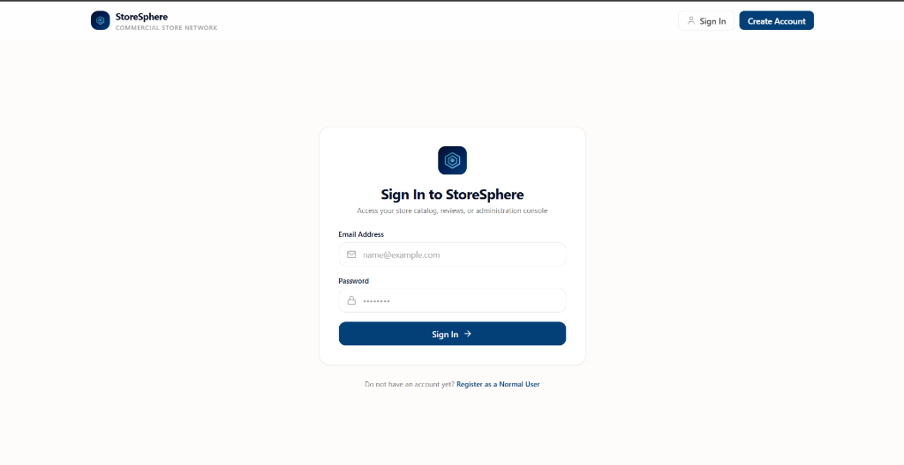
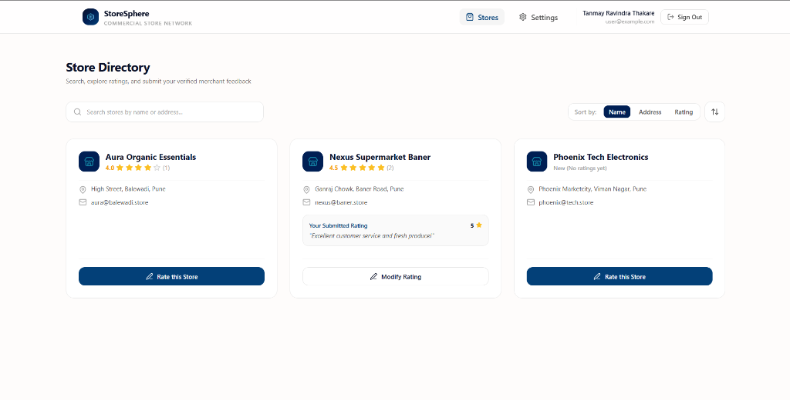
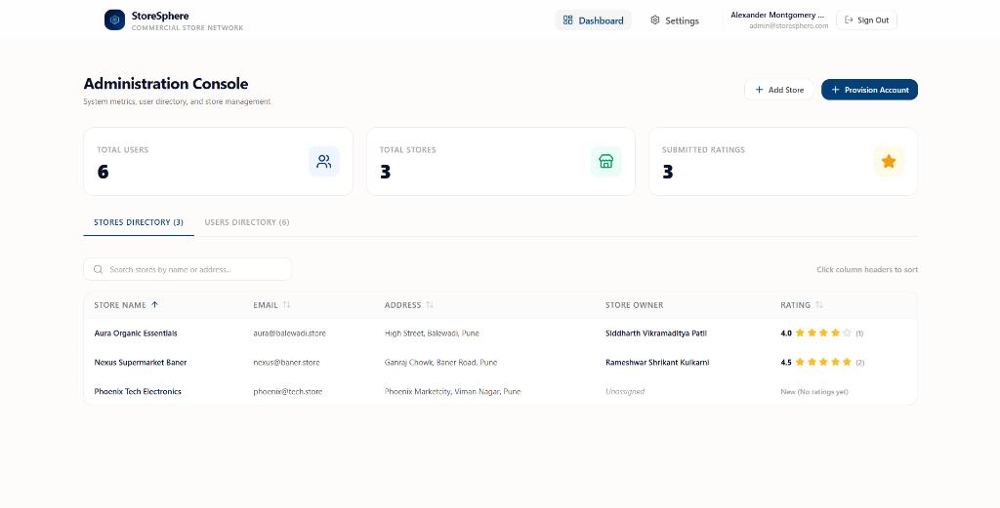
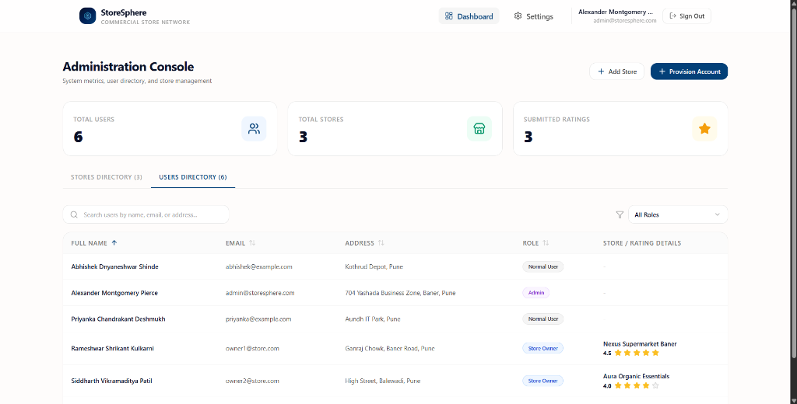
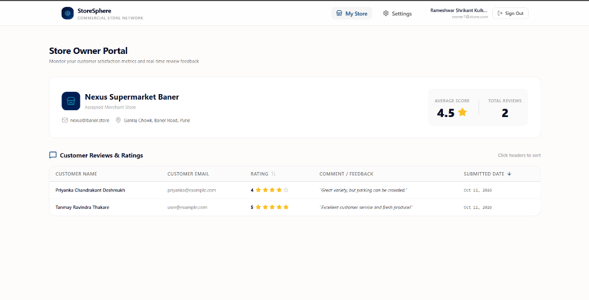
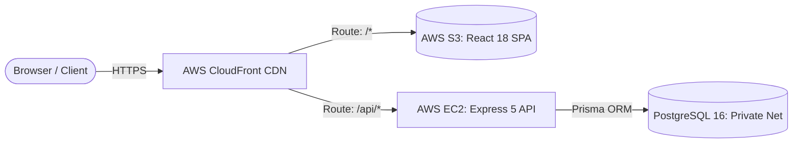
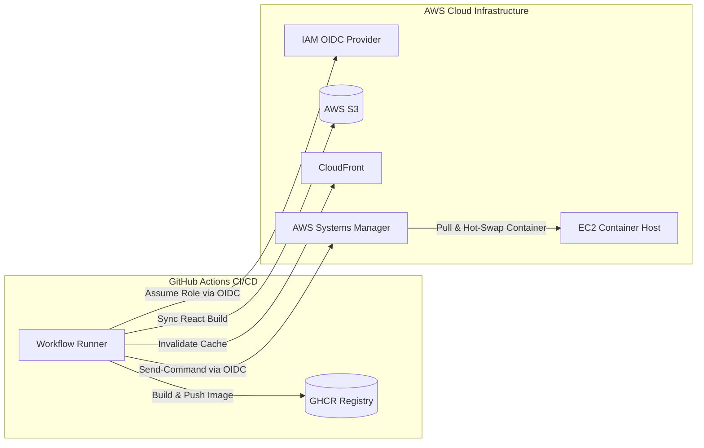

<div align="center">

# StoreSphere

**Commercial Store Directory & Rating Management Engine**

<p align="center">
  <a href="https://github.com/tanmayythakare/store-sphere/actions/workflows/ci.yml"></a>
  <a href="https://github.com/tanmayythakare/store-sphere/actions/workflows/cd.yml"></a>
  <a href="https://www.typescriptlang.org/"></a>
  <a href="https://react.dev/"></a>
  <a href="https://nodejs.org/"></a>
  <a href="https://expressjs.com/"></a>
  <a href="https://www.postgresql.org/"></a>
  <a href="https://www.prisma.io/"></a>
  <a href="https://tailwindcss.com/"></a>
  <a href="https://jestjs.io/"></a>
  <a href="LICENSE"></a>
</p>

<p align="center">
  Multi-role commercial directory, store review feed, and community rating platform.<br>
  Built with Express, PostgreSQL 16, Prisma ORM, and React 18.
</p>

<p align="center">
  🌐 <strong>Live Production Domain:</strong> <a href="https://storesphere.tanmayythakare.online"><strong>https://storesphere.tanmayythakare.online</strong></a><br>
  ⚡ <strong>CloudFront CDN Endpoint:</strong> <a href="https://d115c1ev3w1apg.cloudfront.net"><code>https://d115c1ev3w1apg.cloudfront.net</code></a><br>
  🩺 <strong>API Health Endpoint:</strong> <a href="https://storesphere.tanmayythakare.online/api/health"><code>https://storesphere.tanmayythakare.online/api/health</code></a>
</p>

<p align="center">
  <a href="#quick-flow">Quick Flow</a> •
  <a href="#visual-showcase">Visual Showcase</a> •
  <a href="#system-architecture">Architecture</a> •
  <a href="#ci-cd--deployment-pipeline">CI/CD Pipeline</a> •
  <a href="#core-features">Features</a> •
  <a href="#demo-credentials">Credentials</a> •
  <a href="#getting-started">Setup</a> •
  <a href="#api-reference">API</a>
</p>

</div>

---

## Quick Flow

```
Register / Sign In  →  Role-Based Routing  →  Store Catalog & Search  →  1–5 Star Rating Upsert  →  Analytics Dashboard
```

---

## Visual Showcase

| Secure Sign In | Store Catalog & Ratings |
| :---: | :---: |
|  |  |
| **Admin Console — Store Management** | **Admin Console — User Directory** |
|  |  |

<br/>

<div align="center">
  <strong>Store Owner Portal — Customer Reviews & Rating Analytics</strong>
  <br/><br/>
  
</div>

---

## System Architecture

StoreSphere employs a secure hybrid cloud architecture deployed on AWS with unified HTTPS delivery via CloudFront:



* **Zero Mixed Content & Zero CORS Issues:** CloudFront routes both static frontend assets (`/*`) and API requests (`/api/*`) through a single domain under unified TLS/SSL.
* **Isolated Database Network:** PostgreSQL port `5432` is strictly internal to Docker's private bridge network, with zero exposure to the public internet.

---

## CI/CD & Deployment Pipeline

The repository features enterprise-grade automated CI/CD using **AWS OIDC**, **GitHub Container Registry (GHCR)**, and **AWS Systems Manager (SSM)**:



1. **Continuous Integration (`ci.yml`)**:
   - Launches an ephemeral PostgreSQL 16 container.
   - Applies Prisma migrations and database seeding.
   - Executes 25 automated Supertest integration tests.
   - Verifies TypeScript build integrity for both client and server.

2. **Continuous Deployment (`cd.yml`)**:
   - **Keyless AWS Authentication:** Authenticates securely using GitHub Actions OIDC (`aws-actions/configure-aws-credentials@v4`) — **zero permanent AWS access keys or passwords stored**.
   - **Frontend Pipeline:** Builds the React Vite bundle, synchronizes to AWS S3 (`s3://store-sphere`), and invalidates the CloudFront distribution cache.
   - **Backend Pipeline:** Builds and pushes multi-stage Docker images to **GitHub Container Registry** (`ghcr.io/tanmayythakare/store-sphere:latest` and commit SHA tags).
   - **Zero-Downtime EC2 Swapping:** AWS SSM dispatches remote container updates directly to EC2, authenticated with GHCR, refreshing `store-portal-app` without restarting PostgreSQL.

---

## Core Features

* **Three-Tier Role-Based Security** — Strict separation between System Administrators, Store Owners, and Normal Users across backend middleware and client route guards.
* **Atomic Rating Upsert Engine** — Composite unique constraint on `(userId, storeId)` guarantees users can update ratings (1–5 stars) without duplicate entries.
* **Strict Domain Validation** — Names strictly between 20–60 characters, auto-normalized lowercase email, and 8–16 character password with uppercase and special character requirements.
* **Real-Time Store Analytics** — Instant calculation of average store ratings, review counts, and system metrics aggregated via parallel database queries.
* **Clean Modern UI** — Single-page application built with custom accessible headless dropdowns, sortable tables, and zero Unicode emojis (pure vector SVG icons).

---

## Demo Credentials

The seeded database includes pre-configured accounts for testing:

| Role | Email Address | Password | Permissions |
| :--- | :--- | :--- | :--- |
| **Platform Administrator** | `admin@storesphere.com` | `Admin@1234` | Full access to metrics, user management, and store provisioning |
| **Store Owner** | `owner1@store.com` | `Owner@1234` | Manage *Nexus Supermarket Baner* and view customer reviews |
| **Normal User** | `user@example.com` | `User@1234` | Browse catalog, search stores, and submit/modify ratings |

---

## Getting Started

### Local Setup

```bash
# 1. Clone repository
git clone https://github.com/tanmayythakare/store-sphere.git
cd store-sphere

# 2. Setup backend
cd server
npm install
npm run db:migrate
npm run db:seed
npm run dev

# 3. Setup frontend (in a new terminal)
cd ../client
npm install
npm run dev
```

* Backend API: `http://localhost:5000`
* Frontend App: `http://localhost:3000`

---

### Docker Stack

Run the complete multi-container stack locally:

```bash
docker compose up --build -d
```

Access the application at `http://localhost`.

---

## Automated Test Suite

StoreSphere includes 25 automated integration tests built with Jest and Supertest:

```bash
cd server
npm test
```

* **Authentication & Validation** (`tests/auth.test.ts`): Name length bounds, lowercase email, password policy, login sessions.
* **Role-Based Access Control** (`tests/rbac.test.ts`): Route protection, role isolation, and access restrictions.
* **Store Rating & Upsert** (`tests/rating.test.ts`): Score limits (1–5), feedback comments, atomic upsert update logic.

---

## API Reference

| Method | Endpoint | Access | Description |
| :--- | :--- | :--- | :--- |
| `POST` | `/api/auth/register` | Public | Register a new normal user account |
| `POST` | `/api/auth/login` | Public | Authenticate and obtain JWT token |
| `GET` | `/api/auth/me` | Authenticated | Fetch authenticated user profile |
| `POST` | `/api/auth/change-password` | Authenticated | Change user account password |
| `GET` | `/api/stores` | Authenticated | Search, sort, and list all stores |
| `POST` | `/api/stores/:id/ratings` | Normal User | Submit or update 1–5 star rating |
| `GET` | `/api/stores/owner/my-store` | Store Owner | View assigned store and customer reviews |
| `GET` | `/api/admin/metrics` | Administrator | Retrieve system-wide metrics |
| `GET` | `/api/admin/stores` | Administrator | List all stores with owner and rating details |
| `POST` | `/api/admin/stores` | Administrator | Create a new store |
| `GET` | `/api/admin/users` | Administrator | List all users with role filtering |
| `POST` | `/api/admin/users` | Administrator | Provision an administrator, owner, or user |
| `GET` | `/api/health` | Public | Service health and heartbeat check |

---

## License

This project is licensed under the [MIT License](LICENSE).
